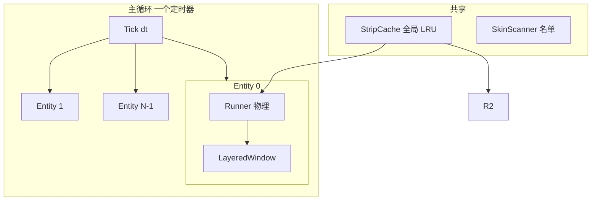

# 多角色 + 武器模式 方案

## 已定的三个决定

1. **装备武器 = 全局开关**。勾一次，桌上所有人一起抽剑/收剑，和 WpfTest 的
   `SetArmedFromTray` 一致。
2. **这轮只做手动装备**。`IsEnemy` / 自动收剑那套规则一个字都不写，等敌人系统
   做完再补 —— 免得拿一个空列表去验证一条永远走不到的分支。
3. **皮肤完整性走宽松 + 标注**。有 `2.Walk` 就认这个人，缺哪个动作就那个动作
   不可用（武器态自动退回走/跑），但托盘名单里要给这个人挂一个「缺武器」的记号，
   别让"能用"和"完整"混成一句话。

参考 `C:\Users\lxy_42\source\repos\WpfTest` 的 `CharacterStore.vb` / `TrayMenu.vb` /
`SpriteSheet.vb` / `RunnerEntity.vb`，把 FalcomDeskling 从"一个角色"扩到"桌上多个角色 +
可切换武器"。

---

## 一、两边现状对照

| 能力 | WpfTest | FalcomDeskling 现在 | 差距 |
|---|---|---|---|
| 角色实例 | `_entities` 列表，动态加/减 | `g_runner` 全局单例 | 要改 |
| 角色名单 | `CharacterStore.Scan()` 扫目录 | `PickSkin()` 扫目录但只留一个 | 要改 |
| 托盘菜单 | 比例/表情/添加/移除/装备/敌人/退出 | 只有"暂停/继续"和"退出" | 要改 |
| 动作集 | 9 套 `1.Run`…`9.Victory` | 只认 `1.Run` / `2.Walk` | 要改 |
| 武器 | `Armed` 开关，跑用 `5.run2`、待机用 `4.standby` | 无 | 要加 |
| 贴图缓存 | 每角色一份 | 每 Runner 一份，`kMax=2` | 要改 |
| 窗口 | WPF 单画布 | 一个分层窗口 | 见下 |

---

## 二、窗口策略：沿用 N 个分层窗口

之前已经定过：**不做层叠（快碰到就互相跑开）的前提下，N 个分层窗口性能更优**。
成本按 `N × 1.1ms` 线性走，8 个角色约 9ms / 33ms 拍，可行。



**注意**：每个 Entity 有自己的 `_box`，所以窗口尺寸各自恒定但互不相同。刚修好的
`srcY` 补偿和边界夹紧都是 per-entity 的，天然兼容，不用改。

---

## 三、必须改的四处硬骨头

### 1. `StripCache` 变成全局共享 —— 这是第一个会崩的地方

现在它是 `Runner` 的成员，`kMax = 2`。8 个角色各拿一份 = **8 × 2 × 2MB = 32MB 常驻**，
而且每个缓存只有 2 格、命中率极低，等于 8 倍重解码。

```cpp
// 从 Runner 里搬出来，按文件路径做 key，改成字节预算
class StripCache {
public:
    static StripCache& Shared();          // 进程唯一
    StripPtr Get(const std::wstring& path);
    void SetBudget(size_t bytes);         // 默认 24MB ≈ 12 条
private:
    std::deque<Entry> _items;
    size_t _bytes = 0, _budget = 24u << 20;
};
```

淘汰按字节而不是按条数，因为以后可能有非 256 格径的角色，每条大小不一样。

### 2. 全局单例改成实体列表

```cpp
struct Entity {
    std::unique_ptr<LayeredWindow> win;
    std::unique_ptr<Runner> runner;
    std::wstring skinName;
};
std::vector<std::unique_ptr<Entity>> g_entities;
```

用 `unique_ptr` 而不是直接 `vector<Entity>`：`Runner::Create` 里存了 `LayeredWindow*`，
vector 扩容会搬对象、指针就废了。

**删除角色时**：先 `runner->Present()` 之外别再碰这个窗口，然后 `reset()` 两个 unique_ptr。
顺序要 `runner.reset()` 再 `win.reset()`，因为 Runner 持有窗口指针。

### 3. `FolderOf` 从"两态"扩到"动作集"

现在只有：

```cpp
const wchar_t* FolderOf(State st) { return st == State::Run ? L"1.Run" : L"2.Walk"; }
```

要扩成 WpfTest 那 9 套的映射，并且**加一个 ArtKind 概念**：

| ArtKind | 目录 | 什么时候用 |
|---|---|---|
| Walk | `2.Walk` | 无武器走路 |
| Run | `1.Run` | 无武器跑 |
| Standby | `4.standby` | 有武器但不走 |
| Run2 | `5.run2` | 有武器跑 |

`Runner::ArtKind()` 取代现在散在 `FolderOf(_state)` 里的写法。

### 4. `ComputeSkinBBox` 的 folders 数组 —— **不改就会重蹈缺脚覆辙**

现在硬编码：

```cpp
const wchar_t* folders[] = { L"1.Run", L"2.Walk" };
```

武器动作一旦加载，`5.run2` 的图**必须**也进这个并集，否则那个动作的内容会超出全局框、
被无声裁掉 —— 症状和刚修好的这个 bug 一模一样，但更难查，因为"框看起来是对的"。

**建议直接改成扫目录**，而不是维护一个数组：

```cpp
// 扫 skinDir 下所有形如 "数字.名字" 的子目录，逐个求框
// 这样加新动作时不用同步改两处
for (auto& e : fs::directory_iterator(skinDir)) {
    if (!LooksLikeActionFolder(e.path().filename())) continue;
    ...
}
```

---

## 四、分阶段实施

### 阶段 1：多角色 + 托盘增删（不含武器）


**启动**：`ScanSkins()` 返回排好序的名单（沿用现在的目录扫描 + `HasWalkSet` 判据，
另外把 `Enemy`/`Resource`/`Chr` 排掉，和 WpfTest 一致）。没给 `--skin` 就随机挑一个。

**托盘**：现在的 `Tray::Popup()` 每次点右键都重新 `CreatePopupMenu`，这正好是
"每次开菜单现编名单"的模型，不用像 WPF 那样挂 `Opening` 事件。加两个子菜单即可：

```
添加 ▸   （名单里还没上场的，全都有名字）
移除 ▸   （此刻在桌上的）
装备武器 ▸（阶段 2 再加）
暂停 / 继续
退出
```

**上限**：先设 8，超了菜单里就不给加（或者挤掉最老的，待定）。

### 阶段 2：武器模式

- `Runner` 加 `bool _armed`，`SetArmed(bool)` 里换 `ArtKind` 并 `LoadFrames()`
- 腿速：`Armed` 时用 `ArmedRunPx`（WpfTest 是 520，正好在走 300 和跑 900 中间）
- 有武器时**不走也不跪**，直接进 Run 态（WpfTest 的行为，照搬）
- 待机：`4.standby` 每 `ArmedIdleEverySec = 10s` 插一段
- 托盘"装备武器"是**全局开关**还是**每个角色单独**？WpfTest 是全局（`SetArmedFromTray`
  遍历所有 entity）。**这里需要你定**，见下面的问题

### 阶段 3：敌人 + 自动装备

你说"当屏幕无敌人时，默认不装备武器"—— 这条规则在 WpfTest 里是：

```vb
If _encTarget IsNot Nothing AndAlso _encTarget.IsEnemy AndAlso _encArmed Then
    SetArmed(True)                      ' 自动抽剑
ElseIf _autoArmed Then
    If _armedClock >= _cfg.DisarmSec Then SetArmed(False)   ' 隔 N 秒自动收
End If
```

**但 FalcomDeskling 现在完全没有敌人系统**（Phase 1 有意砍掉了）。所以现阶段这条规则
等价于"永远不自动装备"。要么：

- **A**：这轮只做"手动装备"，自动装备等敌人系统做完再补
- **B**：这轮就把 `IsEnemy` 的钩子留好（一个假的空列表），规则先写全，以后接敌人不用改逻辑

---

## 五、几个会咬人的细节

**1. 随机种子会撞车。** 现在 `Runner::Create` 里是
`rd() ^ GetTickCount64()`，8 个 Entity 在几毫秒内连续构造，种子高度相关，
可能出现"两个人同时往同一个方向走"。要用索引或地址再混一次。

**2. stats 现在只有一行。** `WriteStatsLine` 读的是 `g_runner.GetStats()`，
多角色后要变成"汇总 + 可选逐行"，否则你没法知道是哪个角色在吃 CPU。

**3. 加角色会卡一下。** `ComputeSkinBBox` 要解 16 条 PNG，几十毫秒。
从托盘点"添加"时如果超过 100ms 会有明显顿感 —— 要么接受，要么把首次加载
推迟到第一拍（先建窗口、后补框）。

**4. 角色之间会穿模。** 现在碰撞只认墙和鼠标。要么加"快碰到就互相跑开"
（复用现成的 `BestFleeVec`，把驱动源从鼠标换成排斥向量），要么先不管。

**5. 皮肤完整性判据要放宽。** WpfTest 要求 9 套齐全才算一个人，
缺图直接跳过这个人。FalcomDeskling 只要求 `2.Walk/dir0.png`。
加了武器之后，**建议按"存在哪些用哪些"降级**，而不是要求齐全 ——
否则你丢一套只有走跑的图进来，武器模式就会去读不存在的文件。

---

## 六、改动范围一览

| 文件 | 改动 |
|---|---|
| `src/wic.h/.cpp` | `StripCache` 改全局字节预算；`ComputeSkinBBox` 改扫目录 |
| `src/runner.h/.cpp` | `ArtKind`、`_armed`/`SetArmed`、`FolderOf` 扩表、种子混合 |
| `src/window.h/.cpp` | 基本不动，`Create` 初始尺寸改成"先按整格、第一拍再 Resize" |
| `src/tray.h/.cpp` | 加 添加/移除/装备 子菜单 + 回调 |
| `src/main.cpp` | `g_entities` 列表、遍历循环、`ScanSkins`、stats 汇总 |
| `src/config.h` | `ArmedRunPx`、`ArmedIdleEverySec`、`MAX_ENTITIES` |

---

## 七、验收标准

- 启动随机一个角色，托盘"添加"能加满到上限，"移除"能清空
- 清空后程序不退出、不崩、不泄漏句柄
- 每个角色独立走位、独立撞墙挑向，不互相卡死
- 装备武器后走/跑换成 `4.standby` / `5.run2` 的图，**且没有内容被裁掉**
  （用 `--debugframe --debugmarks` 逐方向看，脚和武器都在窗口内）
- 8 个角色时 CPU 不超过 12%、常驻不超过 40MB
