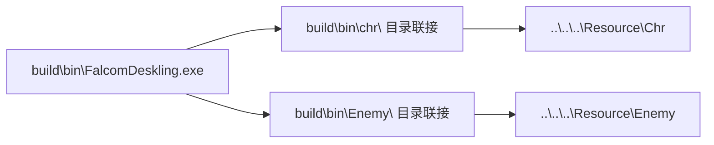
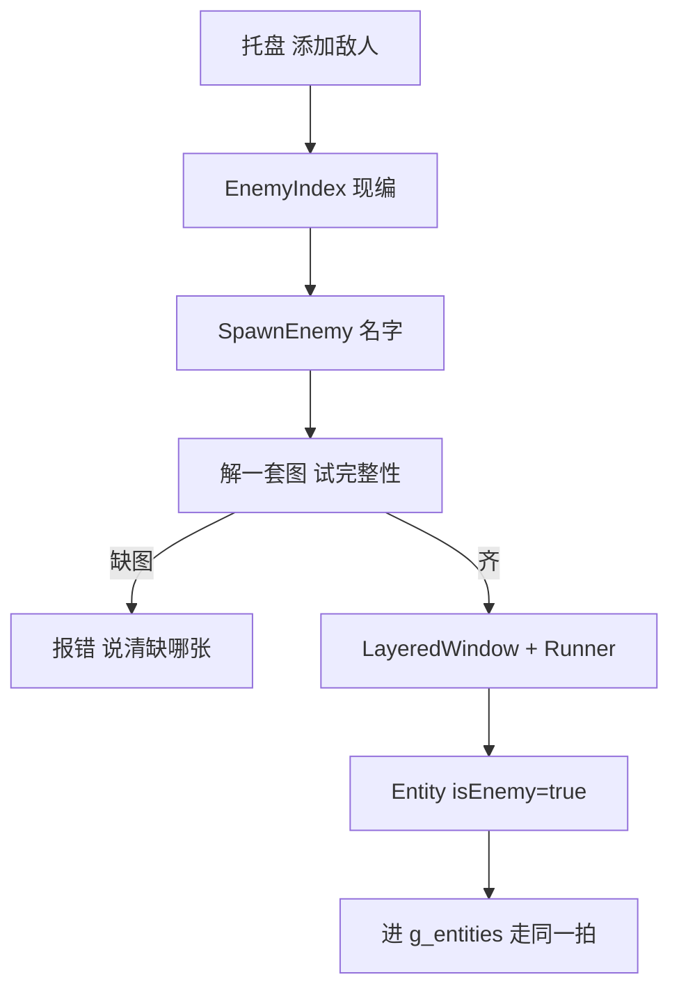

# 四步路线：外部资源目录 → 表情气泡 → 角色配置表 → 敌人加入

按"每步都能独立编译、独立验证、独立回退"来切。四步之间有硬依赖：
第 3 步的 `emoteEvents` 要用第 2 步的表情号数，第 4 步的遭遇要用第 3 步的
`encounters` 表。所以顺序不能换，但每一步做完都是一个能跑的状态。

## 已定的四个决定

1. **气泡走方案 B**：每个角色再开一个分层窗口。窗口数翻倍，但角色自己的
   `ComputeSkinBBox` 一个字都不动 —— 绝不让气泡内容去挤全局框。
2. **XML 自己写**：约 200 行的浅解析器，不引 XMLLite / MSXML。理由见 3.1。
3. **`Separate()` 同伴推开插在配置表之前做**（第 2.5 步）。它比配置表小得多，
   而且是"两人叠在一起"的唯一解药，先把它清掉再动行为参数，出问题好归因。
4. **敌人素材先用 `testdata/ChrBig` 假扮**：这台机器上 `WpfTest\Resource\` 里
   只有 `C_EMOTIO.png` 和 `Chr\`，**没有 `Enemy\`**。第 4 步先用合成目录把
   索引与加入流程跑通，真素材以后再补 —— 见 4.4。

---

## 第 0 步（前置，必须）：资源摆法与构建脚本

现在 [`FindChrRoot()`](../src/main.cpp:86) 是"先翻 exe 往上八级，最后兜到
`C:\Users\lxy_42\source\repos\WpfTest\Resource\Chr`" —— 那条硬编码就是"资源编进
了开发机的路径"。第 1 步要把它拆掉，所以先把构建侧的路子打通。



`build.cmd` 末尾加一段（`mklink /J` 不要管理员权限）：

```bat
if not exist "%OUT%\bin\chr"    mklink /J "%OUT%\bin\chr"    "..\..\..\Resource\Chr"    >nul
if not exist "%OUT%\bin\Enemy"  mklink /J "%OUT%\bin\Enemy"  "..\..\..\Resource\Enemy"  >nul
```

- 联接断了（换机器、源码树挪了）就照实报错，**不要**再偷偷兜到某个绝对路径。
  这条很重要：以前那条兜底让"资源找不到"看起来像"这个人缺图"，白查半天。
- 发布时把两个联接换成真目录即可，exe 一行都不用改。

---

## 第 1 步：`chr\` 动态名单 + `Enemy\` 只建索引

### 新增 `src/store.h` / `src/store.cpp`

把现在散在 [`main.cpp`](../src/main.cpp:86) 和 [`wic.cpp`](../src/wic.cpp:193) 里的
"上哪儿找人"收进来，两个 root 分开找 —— 借 `ChrRoot()` 会跑去找 `chr\Enemy`
那个根本不存在的夹，WpfTest 那边 [`EnemyStore.vb:28`](C:/Users/lxy_42/source/repos/WpfTest/WpfTest/EnemyStore.vb:28) 专门写了这条教训。

```cpp
namespace fd {

struct SkinInfo {          // 现在在 wic.h:48，搬过来
    std::wstring name;
    std::wstring dir;
    bool hasStandby = false;   // 武器两套齐不齐
    int  id = 0;               // 第 3 步从 character.xml 读，先留 0
};

// 只看 exe 旁边，找不到就报错，不再兜绝对路径
const std::wstring& ChrRoot();
const std::wstring& EnemyRoot();

// 排过序：菜单和"随机定主角"都从这儿拿，顺序定下来才不会每次启动换个样子
std::vector<SkinInfo> ScanChr();

// 敌人：启动时只枚举目录名，一张图都不解
std::vector<SkinInfo> ScanEnemyIndex();

}  // namespace fd
```

**索引只枚举、不解码**。WpfTest 的 `EnemyStore.Scan()` 会拿 `SkinIsComplete`
去解码八张条带，所以它自己写着"只能被点一下才叫到，不许摊到启动的某一拍"
（[`EnemyStore.vb:105`](C:/Users/lxy_42/source/repos/WpfTest/WpfTest/EnemyStore.vb:105)）。
我们这边 150 个夹要是启动就全扫一遍，冷启动会难看到不能忍。折中：

| 时机 | 做什么 |
|---|---|
| 启动 | `Directory.GetDirectories` 拿名字，建 `name → dir` 一张表 |
| 开托盘"添加敌人" | 同上，只多算一个 `looksLikeEnemy` 的粗筛 |
| 真要点名加入 | 这时才 `ComputeSkinBBox` + 试解一套图，缺图就报错并说清缺哪张 |

### 托盘改动

- `添加` 子菜单 = `ScanChr()` 里还没上场的（[`tray.cpp:66`](../src/tray.cpp:66) 现编那套不动）。
- `Enemy\` **不进这个菜单**。第 4 步才加"添加敌人"子菜单，这一步先把索引建起来、
  在 `--stats` 里能报一句 `enemy_index=150` 证明它活着就够了。
- `ScanChr()` 要显式跳过 `Enemy` 这个叶子名 —— 现在 [`wic.cpp:202`](../src/wic.cpp:202)
  已经跳了，搬进 store 时别丢。

### 验证

```
tools/run_multi.ps1 -Skins all          # 名单还是 8 个，一个不多一个不少
tools/probe_live.ps1                    # 断掉联接后是不是老实报错而不是乱兜
```

---

## 第 2 步：表情气泡，PNG 编进 exe

### 2.1 内嵌资源

`C_EMOTIO.png` 是 256×256 的一张整图，WpfTest 也是 `<Resource Include>` 内嵌
（[`WpfTest.vbproj:56`](C:/Users/lxy_42/source/repos/WpfTest/WpfTest/WpfTest.vbproj:56)），
理由一样：一张图用不着摆成目录。

```
resource/emotio.png          ← 从 WpfTest\Resource 拷一份进来，进版本库
resource/app.rc              ← IDR_EMOTIO RCDATA "emotio.png"
build.cmd                    ← rc /fo build\obj\app.res  +  link 时带上 app.res
```

`rc.exe` 在 Windows SDK 里，`vcvars64.bat` 会把它带上 PATH。万一这台机器没有，
退路是用 PowerShell 把 PNG 转成 `src/emotio_blob.cpp` 里的一个字节数组 —— 256×256
的 PNG 也就十几 KB，编进去毫无压力。**先按 rc.exe 做，别一上来就写 bin2c。**

解码要新开一条路：`FindResourceW` → `LoadResource` → `CreateStreamOnHGlobal` →
`IWICImagingFactory::CreateDecoderFromStream`。[`DecodePngStrip()`](../src/wic.cpp:72)
现在只吃文件名，加一个 `DecodePngStream(IStream*, Strip&)` 把中间那段共用出来。

### 2.2 `src/emote.h` / `emote.cpp`

两张表，照 [`EmotionSheet.vb`](C:/Users/lxy_42/source/repos/WpfTest/WpfTest/EmotionSheet.vb) 抄：

```cpp
enum class EmotionId : int { 疑问=1, 惊叹=2, ..., 任务=18 };
constexpr int EMOTE_LAST_ID = 18;
constexpr int EMOTE_CELL    = 32;   // 8 列 8 行

// 每个号数对应 2~6 帧；狂怒那两帧要往上多带一格
struct EmoteFrames { const RECT* rects; int count; };
```

`slotUp` 这个坑必须照搬：[`EmotionSheet.vb:82`](C:/Users/lxy_42/source/repos/WpfTest/WpfTest/EmotionSheet.vb:82)
里 `狂怒` 的第 3、4 帧火星画在上半行，只取 `slot(46)` 会缺一截。

### 2.3 气泡窗口：走"一人一个额外窗口"

| 方案 | 代价 | 判断 |
|---|---|---|
| A. 画进角色自己的表面 | 气泡得进 `ComputeSkinBBox` 并集框，否则被窗口裁掉 | **否**：会把刚修完的"无声裁掉"那类问题再引一遍 |
| B. 每角色再开一个分层窗口 | 8 人 → 16 窗口，成本约 ×2 | **已选**：和现有"一个角色一个窗口"的哲学一致 |

成本怎么压住：气泡窗口只在 `Busy()` 时才 `Present`，静默时 `Show(false)` 收起来，
一个像素都不传。这样"没人冒脸"的时候这 16 个窗口是零成本的。

`EmoteBubble` 的成员：

```cpp
class EmoteBubble {
public:
    bool Create();                       // 独立 LayeredWindow，点击穿透
    void Show(int id, double seconds);
    void Hide();
    void Tick(double dt, Vec2 ownerPos, double headY, double k);
    bool Busy() const;
private:
    std::unique_ptr<LayeredWindow> _win;
    int _id = 0, _frame = 0;
    double _clock = 0, _showLeft = 0;
    int _maxW = 0, _maxH = 0;            // 整组最大框，见下面那条坑
};
```

**两条必须照搬的坑**（都在 [`EmoteBubble.vb:202`](C:/Users/lxy_42/source/repos/WpfTest/WpfTest/EmoteBubble.vb:202)）：

1. 尺寸**不能**按当前帧走。狂怒前两帧 32 高、后两帧 64 高，拿 `PixelHeight` 定位
   会让泡泡每 300ms 往上蹿一次，看着就是坐标在抖。用整组 `_maxW/_maxH` 定死，
   矮帧贴到盒底，尾巴照样指头。
2. 底沿按**这一拍真的头顶**算，不能拿 `BodyLen=82` 那把尺子。我们这边正好有现成的：
   [`Runner::ExtUp()`](../src/runner.h:151) 就是从全局框推出来的"脚底到窗口顶"，
   `headY = pos.y - ExtUp()`。这条比 WpfTest 那三层回落表还干净。

### 2.4 接口

```cpp
// Runner 上开三个口子，和 Character.vb 那三个同名同义
void ShowEmote(int id, double seconds = 2.4);
void NotifyEmote(EmoteEvent e);
void HideEmote();
```

`EmoteEvent` 先只接**已经有触发点**的那三个，剩下六个等第 3/4 步：

| 事件 | 触发点 | 状态 |
|---|---|---|
| `Armed` | [`SetAllArmed()`](../src/main.cpp:212) | ✅ 现成 |
| `Touched` | [`BodyHit()`](../src/runner.cpp:328) + `FlickAway` | ✅ 现成 |
| `BumpWalk` / `BumpRun` | 撞墙挑向那里 | ✅ 现成 |
| `MouseNear` | `SetState(Run)` 边界 | ⚠️ 一行 |
| `PeerBump` | 要等同伴推开 | ❌ |
| `RestBegin` / `Stun` / `Hurt` | 要等休息态和战斗 | ❌ |

托盘加 `表情` 子菜单，1..18 直接列出来，点谁放谁 —— 这一步做完，
`ShowEmote` 就有了一条不用改代码就能逐张验的路。

### 2.5 验证

```
tools/probe_live.ps1 --emote=13        # 狂怒：看会不会往上蹿
tools/probe_frames.ps1                 # 逐帧对 atlas 坐标
```

---

## 第 2.5 步：同伴推开 `Separate()` ✅ 已完成

放在配置表之前，是因为它小、独立，而且是"两人叠在一起"的唯一解药 —— 先把
这个清掉，第 3 步调行为参数时出问题才知道是谁干的。

**做的时候撞见两件事，都记在这儿，省得下次再踩**：

1. `PeerBox()` 的半宽是 `HalfW + 6`，而原来 `BodyHit()` 里只用了 `HalfW`。
   两边各用各的，`PeerAhead` 和鼠标命中就会对不上。现在 `BodyHit` 直接
   `return PeerBox().Contains(...)`，一份框两处用。
2. **`rect=` 量不出"两个人叠没叠在一起"**。它是带余量的全局框，一条边就三百
   多像素，两个人离得老远 `rect=` 照样互相盖住 —— 拿它算重叠面积，结论会反
   （实测"关掉推开"反而重叠更少，纯属噪声）。要看的是**脚底锚点之间的距离**，
   `pos=` 直接给了。

### 要补的三个函数

| 名字 | 照搬处 | 干什么 |
|---|---|---|
| `Runner::PeerBox()` | [`TouchRect()`](C:/Users/lxy_42/source/repos/WpfTest/WpfTest/RunnerEntity.vb:1365) | 返回 `Rect{pos.x±(HalfW+6), pos.y-BodyLen-4 .. pos.y+4}`，和 [`BodyHit`](../src/runner.cpp:328) 共用一份，**不许画第二套碰撞框** |
| `Runner::PeerAhead(dir)` | [`PeerAhead`](C:/Users/lxy_42/source/repos/WpfTest/WpfTest/RunnerEntity.vb:1410) | 沿 `d` 探一个身长，会不会撞进谁的身体框 |
| `SeparateAll()` | [`Separate`](C:/Users/lxy_42/source/repos/WpfTest/WpfTest/RunnerEntity.vb:1433) + [`SeparateFrom`](C:/Users/lxy_42/source/repos/WpfTest/WpfTest/RunnerEntity.vb:1447) | 两两看一眼，重叠了就各推一半 |

`Runner` 这边缺一个 `SetPos(Vec2)` —— 原版 `SeparateFrom` 是直接改 `_pos` 的，
我们得留一个口子让外面改。

### 接进主循环

[`main.cpp`](../src/main.cpp:713) 那个"先全员 Tick 再全员 Present"中间插一趟：

```
for e in entities: e->runner->Tick(dt, mouse);
SeparateAll(entities);              // ← 新增
for e in entities: e->runner->Present();
```

**这条推挤不算撞墙**：不走 `Move`、不碰 `IntoWall` 的边界、也不留 `lockEdge`。
它只把位置修回来 —— 真上锁的话后面十几拍的放锁条件会一直被一处不该有的账牵着
（[`RunnerEntity.vb:1431`](C:/Users/lxy_42/source/repos/WpfTest/WpfTest/RunnerEntity.vb:1431)
那段注释就是讲这件事，别自己发明第二套）。

### 顺手清掉一个死常量

[`ScoreFlee()`](../src/runner.cpp:564) 里补一档同伴惩罚，把
[`config.h:62`](../src/config.h:62) 那个从没被引用过的 `PEER_PENALTY = 500.0`
真正接上。这样"躲的时候"也会绕开人，而不只是撞上了再推开。

### 验证

`tools/run_multi.ps1 -Skins all` 看不出来：八个人散在 1920x1152 上本来就难得
靠近，`SeparateFrom` 那条路根本走不到，跑一百拍也只是"两边都一样"。得先把
他们逼到同一只脚底上，才看得出分不分得开。

```
tools/check_separate.ps1 -Seconds 15
```

它跑两遍 —— `--stack` 和 `--stack --noseparate` —— 把每一拍的"最近那一对离多
远"排成序列比。实测：

```
ON   190 429 190 327 217 190 ...   平均 226px
OFF   37  37  36 189 406 314 ...   平均 185px
```

`--noseparate` 是**总开关**，推挤和绕人一起关。只关推挤不算对照 —— 绕人那一
路还在起作用，量出来的差值说不清是谁的功劳。

`peer=` 在 stats 的 `t=` 行上，数的是"这一拍为了绕开同伴换了向"的次数：
开着十几到二十几，`--noseparate` 下恒为 0。

---

## 第 3 步：`character.xml` 式配置表

### 3.1 解析器：自己写（已定）

配置很浅（一层根 + 几层子节点，全是属性），自己写一个 200 行的读取器比
拖一个 COM 依赖进来划算，也和这个项目"没有 CMake、纯 cl.exe"的脾气一致。
要处理的就四样：注释 `<!-- -->`、自闭合 `<x/>`、实体 `" & < >`、
属性值里的空格。

`XmlLite` 和 `MSXML` 都记在这里备查，但**不建议**：前者是流式 API，读个属性
要转三圈；后者依赖 MSXML 6.0 的 COM 注册，装不干净就是一句 `NoClassRegistered`。

### 3.2 `src/charconf.h` / `charconf.cpp`

```cpp
struct CharacterConfig {
    int    id = 0;
    std::wstring name;
    // 速度
    double walkPx = WALK_PX, runPx = RUN_PX, armedRunPx = ARMED_RUN_PX;
    // 表情
    std::vector<int> emotePool;      // <emotes random="3,4,10"/>
    double emoteGapSec = 30.0, emoteShowSec = 2.4;
    // 事件 → 脸
    std::map<std::wstring, std::vector<int>> eventEmote;
    bool eventDefault = true;
    // 遭遇
    double encNearLen = 1.5, encFarLen = 4.0;
    struct Encounter { int byId; std::wstring byName; int far, near; std::vector<int> emoteFar, emoteNear; };
    std::vector<Encounter> encounters;
    bool armedDefault = false;
    // 动作开关
    std::set<Art> artOff;
};
const CharacterConfig& ConfigFor(const std::wstring& skinDir);   // 按目录缓存
```

**优先级必须是 `默认值 < character.xml < 命令行`**。这条是"没有文件 = 今天的她"
那条基线能立住的前提，WpfTest 在 [`CharacterConfig.vb:116`](C:/Users/lxy_42/source/repos/WpfTest/WpfTest/CharacterConfig.vb:116)
把这件事说得很死：搬进 xml 之后那条等式不许断。

### 3.3 分别测试：这一步的重点

"可分别测试"不是加个开关就完事，得让每一条触发都能**单独逼出来**：

| 手段 | 干什么 |
|---|---|
| `--dumpconfig` | 把这个人最终生效的整张表打出来再退出。配置没生效最常见的原因就是"文件没找到"或"属性名写错"，这一步先把它变成看得见的东西 |
| `--no-config` | 强制全走默认值，用来证明"xml 那一路真的在起作用" |
| `--emote=N` | 跳过所有计时器，直接放第 N 张脸 |
| `--peer=名字` | 在固定偏移处放一个指定的人，专门验 `encounters` 里那条 `<other id="1"/>` |
| `--enc=near/far` | 钉死当前落在哪一档，省得为了凑距离在桌上追半小时 |
| 托盘 `表情` 子菜单 | 逐张放，第 2 步已经给了 |

`--peer` 这条尤其值：`encounters` 的判据是"谁 + 多远"，光靠随机走位根本
复现不了一条规则，测试就变成了玄学。

### 3.4 接线

`Runner::Options` 里那些从命令行来的数，改成先问 `ConfigFor()`。
注意 [`CurrentSpeedPx()`](../src/runner.h:138) 和
[`WANDER_SEC`](../src/config.h:53) 这些现在是常量，要换成成员字段，
默认值还是那两个常量 —— 这样没配置的人行为一个字都不变。

---

## 第 4 步：敌人加入，先做单个

### 4.1 动作集从 4 套扩到 9 套

[`wic.h:41`](../src/wic.h:41) 现在 `ART_COUNT = 4`。扩到 9 会**同时改掉**
[`ComputeSkinBBox`](../src/wic.cpp:218) 的扫描范围（它按 `a < ART_COUNT` 循环），
也就是说**所有人的全局框都会变**。这不是 bug，是必须付的账 —— 但必须重跑
`tools/check_all_skins.ps1` 确认没有哪套动作被挤出去，这正是上一轮刚修完的那类问题。

| Art | 目录 | 我方 | 敌人 |
|---|---|---|---|
| Run | `1.Run` | ✅ | ❌ 没有 |
| Walk | `2.Walk` | ✅ | ❌ 没有 |
| Kneel | `3.kneel` | ❌ 先不接 | ❌ |
| Standby | `4.standby` | ✅ | ✅ |
| Run2 | `5.run2` | ✅ | ✅ |
| Attack | `6.Attack` | ❌ | ✅ |
| BeAttacked | `7.BeAttacked` | ❌ | ✅ |
| Kneel2 | `8.Kneel2` | ❌ | ✅ |
| Victory | `9.Victory` | ❌ | ❌ |

敌人的完整性判据是"这五套齐"，不是"有 `2.Walk`" —— 所以 [`HasWalkSet()`](../src/wic.cpp:185)
那套判据必须分叉，否则敌人会被全部判成"缺图"然后一个都加不出来
（[`EnemyStore.vb:73`](C:/Users/lxy_42/source/repos/WpfTest/WpfTest/EnemyStore.vb:73) 里那条注释讲的就是这个坑）。

### 4.2 单个加入



`Entity` 加一个 `bool isEnemy`，[`AddEntity`](../src/main.cpp:138) 拆成
`AddSkin(si)` / `AddEnemy(si)` 两个入口，共用建窗口那段。

**这一步只做"它站在那儿"**：待机放 `4.standby`，走动放 `5.run2`，
慢速游荡，不攻击、没有血条、不会挨打。理由是：
`IsEnemy` 这个字段本身就该在这一轮立起来（第 3 步的 `encounters` 里
`<other id="100" far="chase" near="attack"/>` 要靠它认谁怪），
但战斗是另一件事，别混在一起验。

### 4.3 之后才做的（明确划出去）

- 血条、`Hp`、`BeAttacked` 的硬直
- `Attack` 的出手判定与 `attackLen`
- 自动抽剑/收剑（`DisarmSec`）

（同伴推开 `Separate()` 已经提到第 2.5 步做了，不在这张表里。）

### 4.4 敌人素材：不用合成，这台机器上已经有真的

第 1 步建索引时才发现：`build\bin\Enemy\` 底下已经有 **247 个 `CH*` 夹**，每个都
带 `4.standby / 5.run2 / 6.Attack / 7.BeAttacked / 8.Kneel2` 这五套 —— 正是
[`EnemyStore.vb:99`](C:/Users/lxy_42/source/repos/WpfTest/WpfTest/EnemyStore.vb:99)
说的"这五套才是敌人真的有的东西"。`build\bin\Chr\` 也是 14 个人，比兄弟仓库那
8 个还多。

所以 `tools/make_fake_enemy.ps1` **不用写了**，第 4 步直接拿真素材验。

> 之前"这台机器上没有 `Enemy\`"那句判断是错的：它看的是
> `WpfTest\Resource\Enemy`，而真正的资源早就摆在 `build\bin\Enemy` 里 ——
> 这恰好就是第 0 步"只看 exe 旁边那一级"想立住的规矩。

一个必须留意的后果：**247 个夹 × 五套图**，索引再快也不能解码。第 1 步那条
"枚举与解码分离"现在不是洁癖，是硬要求：真去扫一遍 `Enemy\` 的完整性，
冷启动会直接变成几十秒。

---

## 风险清单

| 风险 | 影响 | 对策 |
|---|---|---|
| `ART_COUNT` 4→9 改了所有人的框 | 可能重演"缺脚" | 第 4 步合并前必跑 `check_all_skins.ps1` |
| 敌人目录没有 `2.Walk` | 完整性判据一错就一个都加不出来 | 判据按 `isEnemy` 分叉 |
| `Enemy\` 有 247 个夹 | 启动扫完整性 = 冷启动几十秒 | 枚举与解码彻底分开，加人那一刻才解 |
| 气泡窗口 ×2 | 8 人 + 8 泡 = 16 窗口，`Present` 成本翻倍 | 泡泡只在 `Busy()` 时上传，静默时 `Show(false)` |
| 索引启动就解码 | 冷启动从 0.3s 变 3s | 枚举与解码分离，见第 1 步那张表 |
| rc.exe 不在 SDK 里 | 构建直接断 | 备一条 bin2c 退路，但先别写 |
| 自己写的 XML 读取器 | 属性名拼错只会静默失效 | `--dumpconfig` 把解析结果原样打出来 |

---

## 落地顺序

1. ✅ 第 0 步 + 第 1 步：`store.cpp` + 两个联接 + 菜单改走 `ScanChr()`。
2. ✅ 第 2 步：`app.rc` 内嵌 → `DecodePngStream` → `EmotionSheet` → `EmoteBubble`
   （方案 B）→ 托盘表情菜单。
3. ✅ 第 2.5 步：`Separate()` 同伴推开，把 `PEER_PENALTY` 那个死常量接上。
4. 第 3 步：自写 XML 读取器 → `charconf.cpp` → 接线 → 六个测试开关。
5. 第 4 步：`Art` 扩表 → 敌人判据分叉 → `AddEnemy` → 托盘"添加敌人"。
   **不写 `make_fake_enemy.ps1`** —— 见 4.4：这台机器上 `build\bin\Enemy\` 已经有
   247 个真 `CH*` 夹，合成素材那条作废。
