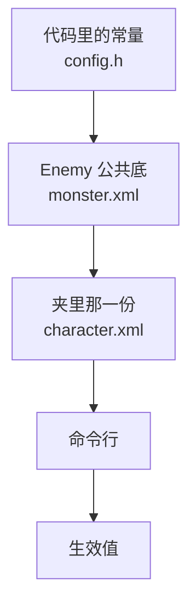
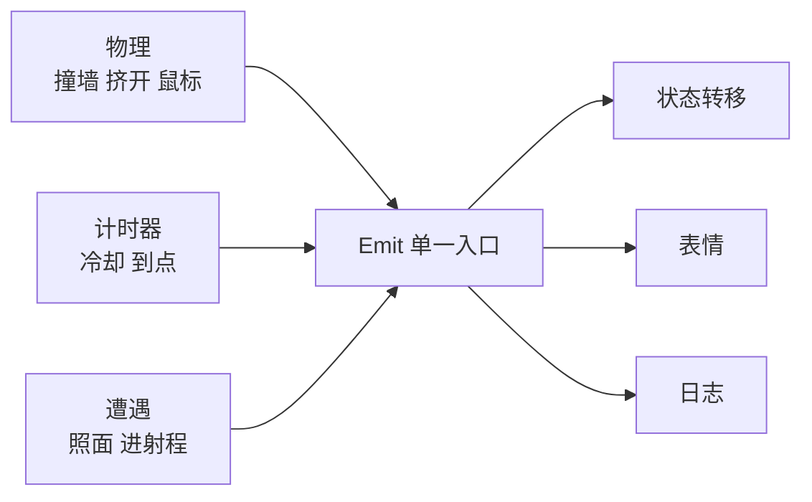

# 第 3 步设计：character.xml 配置表 + 阵营 ID 空间 + 状态响应

> 这一份是"构思"，不是施工单。施工单要在下面三个待定问题拍板之后再拆。

## 0. 这一轮比路线图多做的那件事

路线图 [`roadmap-assets-emote-config-enemy.md`](roadmap-assets-emote-config-enemy.md) 第 3 步只写了"把参数搬进 xml"。
按你这次的要求，还要多做两件：

1. **ID 不再只是"哪一类"**，而是**带阵营含义的编号空间**：我方 1~100、敌方角色 101~200、敌方怪物 201~1000。
2. **响应要按状态分**，不是"撞上谁换一张脸"那么扁平。

WpfTest 那边的 `id` 是"同类可以共用一个号"（[`CharacterConfig.vb:151`](C:/Users/lxy_42/source/repos/WpfTest/WpfTest/CharacterConfig.vb:151)），
怪物全桌共用 `MonsterId = 100` 一个号。**我们这边把它改成区间编码**，这是一处实打实的偏离，
所以下面第 1 节要把偏离的后果一条条写清楚。

---

## 1. ID 空间

### 1.1 三段区间


| 区间 | 名字 | 默认 id | 有血条 | 会自己装备 |
|---|---|---|---|---|
| 1~100 | Ally | `ScanChr()` 的排序序号 + 1 | 否 | 看 `<armed default>` |
| 101~200 | EnemyChar | **没有默认**，只能显式写 | 是 | 是 |
| 201~1000 | Monster | **全部共用 201** | 是 | 是 |
| 0 | Unset | 没写过 | — | — |
| -1 | Wild | 只能出现在查找规则里 | — | — |

> **201~1000 是一个「可分」的空间，不是一个「必须分完」的空间。** 这是本轮拍板的结果，
> 理由见 1.5。

### 1.2 阵营是**派生**出来的，不是第二个字段

这条是整节里最要紧的一条。`SkinInfo` 现在已经有 `int id`（[`store.h:15`](src/store.h)），
WpfTest 另有一个 `bool IsEnemy`。**两处定义迟早会对不上** —— 就会出现"血条有、遭遇表里却当她是我方"这类查不动的账。

```cpp
enum class Faction : int { Unset = 0, Ally = 1, EnemyChar = 2, Monster = 3, Wild = -1 };

// 唯一的出处。别的地方一律不许再写一遍 if (id >= 101 && id <= 200)
Faction FactionOf(int id);
bool    IsHostile(int id);      // EnemyChar || Monster
bool    HasHp(int id);          // 同上，但语义是"有没有血条"而不是"是不是敌人"
```

`IsEnemy` 这个 bool **不要**再进 `CharacterConfig`。它只能是 `FactionOf(id) != Ally` 的别名，
而且最好连别名都别留，直接问 `Faction`。

### 1.3 区间的边界要能改，但不能散着改

边界写死在代码里，将来想加一段"友方 NPC 1001~2000"就得动 `FactionOf`。
所以边界进一张表，`FactionOf` 只查这张表：

```cpp
struct FactionBand { int lo, hi; Faction f; };
extern const FactionBand kFactionBands[];   // 顺序即优先级，第一个命中的算
```

一张表上写完全部分段，`--dumpconfig` 直接把它打出来。**不许**在别处出现字面量 100 / 200 / 1000。

### 1.4 发号：谁给谁发

| 来源 | 怎么定 id |
|---|---|
| xml 里写了 `id=` | 就用它，越界就报错并拒绝加载这个人 |
| `Chr\` 下没写 | 按 `ScanChr()` 的**排序序号** + 1 落在 1~100 |
| `Enemy\` 下没写 | **一律 201**，不看目录顺序 |
| 两处写了同一个**显式** id | 报 `撞号`，后加载的那一个不降级不重号，直接拒绝上场 |

**撞号判据有个坑**：247 只怪全都合法地共用 201，所以**不能**一见重复就报。
规则是「**只有显式写出来的 `id=` 才参与撞号检查**」——
`ScanEnemyIndex()` 打的那个 201 是派生值，不进撞号表。
WpfTest 那边写的是"只有号数不等于 0 才报"（[`AGENTS.md:677`](C:/Users/lxy_42/source/repos/WpfTest/AGENTS.md)），
同一个思路，只是哨兵值从 0 换成了"派生"这个标记。

### 1.5 已定：怪物共用 201，点单只靠名字

**拍板结果**：`Enemy\` 底下 247 个夹**全部默认 201**，差别只在图上。
想点名单只，走两条路之一：

```xml
<other name="CH00260" far="chase" near="attack"/>   <!-- 遭遇表里点它 -->
```
或者在 `Enemy\CH00260\character.xml` 里写 `id="207"`，**它从此永久固定**，
不再跟着目录顺序漂。

这么定的理由：
- 目录名天生不撞，`name=` 是稳的身份证；顺序 id 一增删就全体错位。
- 247 只怪的差别本来就该在图上，不该散在 247 份文件里
  （[`CharacterXml.vb:11`](C:/Users/lxy_42/source/repos/WpfTest/WpfTest/CharacterXml.vb:11) 同一条理由）。
- 区间编码仍然成立：201~1000 是**可分**的空间，不是**必须分完**的空间。

**代价，要认**：默认情况下调不了单只。谁想调，先给那只放一份 `character.xml`。
这条会写进 `--dumpconfig` 的输出里，免得有人找了半天找不到地方下手。

---

## 2. 配置分层与优先级



**优先级 `常量 < monster.xml < character.xml < 命令行`**，这条不许破。
它撑的是那条基线：**一个文件都没有的时候，每个数都必须等于 `config.h` 里那个**。
路线图 [`:297`](roadmap-assets-emote-config-enemy.md) 把这条说得很死，WpfTest 在
[`CharacterConfig.vb:116`](C:/Users/lxy_42/source/repos/WpfTest/WpfTest/CharacterConfig.vb:116) 也立了同样的规矩。

`monster.xml` 只在 `EnemyRoot()` 底下找一份，**两趟加载**：先灌公共底，再让夹里那份盖上去。
只写了部分字段的人，没写的字段照公共底，**不要**为了"看起来完整"把公共那几行抄一份进来
——将来公共那份一改，这一只就会悄悄留在旧数值上（[`AGENTS.md:1536`](C:/Users/lxy_42/source/repos/WpfTest/AGENTS.md) 那条）。

**判"这个字段有没有被写过"要用三态**，不能用"值等于默认"：

```cpp
template <class T> struct Opt {
    bool     set = false;
    T        v{};
    T valueOr(T dflt) const { return set ? v : dflt; }
};
```

`walk="300"` 明明写了、和没写，在生效值上一模一样，但在**排障**上是两回事：
`--dumpconfig` 必须能说出"这一项是 xml 第 12 行给的"还是"这是常量"。
这个能力比它看起来重要 —— 配置没生效最常见的原因就是"文件没找到"或"属性名拼错"。

---

## 3. 状态机

### 3.1 状态集

现在只有 `Walk` / `Run` 两态（[`config.h:71`](src/config.h)）。要扩：

| State | 谁会有 | 进态条件 | 出态条件 |
|---|---|---|---|
| `Idle` | 全员 | 站着没人理，超过 `idleSec` | 鼠标近了 / 照面 / 到点自己挪窝 |
| `Walk` | 我方 | 默认 | 距离进 `nearLen` → Run |
| `Run` | 我方 | 鼠标近 | 退到 `farLen` 且走过那么远 → Walk |
| `Chase` | 会追人的 | 遭遇档 = chase | 目标进 `attackLen` → Attack；跟丢了 → Walk |
| `Attack` | 会打的 | 遭遇档 = attack 且冷却到了 | 动画放完 → Chase |
| `BeAttacked` | 有血的 | 被人打中 | 动画放完 → 回被打之前的态 |
| `Stun` | 有血的 | 跪倒概率命中 | `stunSec` 到 → 回原态 |
| `Rest` | 允许歇的 | 逛够 `restAfterSec` | 鼠标近 / 到 `restDurationSec` |
| `Dead` | 有血的 | hp 归 0 | 不自动出，除非配了复活 |
| `Victory` | 打赢的 | 对面倒了 | `victorySec` 到 |

**`BeAttacked` / `Stun` 必须能记住"回来之后去哪"**，否则追人追到一半挨一下，回来就变成乱逛了。
这是个容易漏的点，实现时要在 `State returnTo` 上留一个字段。

### 3.2 转移表是数据，不是 if-else

代码里只留一张内置默认表，xml 可以整段盖掉，也可以只盖几行：

```xml
<states default="builtin">
  <from state="chase">
    <to event="attacked"  state="beAttacked" art="7.BeAttacked" emote="黑线"/>
    <to event="inRange"   state="attack"     cooldown="1.2"/>
    <to event="lost"      state="walk"/>
  </from>
  <from state="any">
    <to event="hpZero"    state="dead"       art="8.Kneel2" emote="none"/>
  </from>
</states>
```

`from state="any"` 是通配行，优先级排在具体行之后。
`default="none"` 的意思和 `<emoteEvents default="none">` 一致：**没写过的转移就不许发生**，
别拿内置表来替这个人做主。

### 3.3 抢占规则要明写

`BeAttacked` 打断 `Chase` 吗？`Dead` 打断一切吗？这类问题不问清楚一定会写成"谁先算谁赢"。
一张表说清：

```cpp
// 数值大的是赢家。同分 = 不许打断，等这一态放完
constexpr int kInterruptRank[] = {
    /* Dead       */ 100,
    /* Stun        */ 80,
    /* BeAttacked  */ 70,
    /* Attack      */ 50,
    /* Chase       */ 40,
    /* Rest        */ 30,
    /* Run         */ 20,
    /* Walk        */ 10,
    /* Idle        */  5,
};
```

**这张表不许进 xml**。它是一组互相有大小关系的排序，不是六个各调各的参数 ——
和 `PeerPenalty` / `Corner*` / `Bounce*` 同一类，WpfTest 在
[`CharacterConfig.vb:195`](C:/Users/lxy_42/source/repos/WpfTest/WpfTest/CharacterConfig.vb:195)
也是这么处理的，理由一样：搬进 xml 之后没人能保证那九个数的序还是对的。

---

## 4. 事件与响应

### 4.1 事件源只有三个，别开第四个



现在 `NotifyEmote(EmoteEvent)` 只往表情一条路上走（[`runner.cpp:1105`](src/runner.cpp:1105)）。
第 3 步要把它升成**一个事件入口，三路分发**：状态、表情、日志。
三路都从同一个 `Emit(ev, byId)` 派生，**不许**在 `Move()` 里直接 `SetState()` 又在别处直接 `ShowEmote()`。

事件表（`byId` = 谁逼出来的，0 = 说不清）：

| 事件 | 现在有没有触发点 |
|---|---|
| `BumpWalk` / `BumpRun` | ✅ [`runner.cpp:262`](src/runner.cpp:262) |
| `MouseNear` / `MouseFar` | ✅ [`runner.cpp:142`](src/runner.cpp:142) |
| `Touched` | ✅ [`runner.cpp:102`](src/runner.cpp:102) |
| `PeerBump` | ✅ 第 2.5 步刚接上 |
| `EncounterFar` / `EncounterNear` | ❌ 要等遭遇表 |
| `InRange` / `Lost` | ❌ 新 |
| `AttackedBy` / `AttackHit` | ❌ 新，第 4 步才真会响 |
| `HpZero` | ❌ 新 |
| `RestBegin` / `RestEnd` | ❌ 新 |
| `Stun` | ❌ 新 |
| `TimerExpired(state)` | ❌ 新 |

路线图 [`:198`](roadmap-assets-emote-config-enemy.md) 说 `PeerBump` 要等同伴推开 —— 第 2.5 步已经做了，
这一项现在可以接。剩下六个是这一轮新开的。

### 4.2 表情映射：三层回落

| 层 | 写法 | 什么时候用 |
|---|---|---|
| 精确 | `event="Hurt" by="2"` | 被某个具体的人打 |
| 阵营 | `event="Hurt" faction="monster"` | 被任何一只怪打 |
| 通配 | `event="Hurt" by="*"` | 谁打都这张脸 |
| 事件级 | `event="Hurt"` | 没分 by 的那一条 |
| 内置 | 代码那张表 | 一个字都没写过 |

`none` = 这里就该安静，**不是**"没配过"。这个区别必须留得出来：
`Nothing` 和空表是两种东西，WpfTest 在 [`CharacterConfig.vb:302`](C:/Users/lxy_42/source/repos/WpfTest/WpfTest/CharacterConfig.vb:302)
专门写了这条，照搬。

### 4.3 遭遇查找链：五级

这是"多留接口"最实在的一处。查找顺序**名字 → 精确 id → id 区间 → 阵营 → 通配**：

```cpp
const Encounter* MatchEncounter(const std::string& peerName, int peerId) const;
```

```xml
<encounters nearLen="1.5" farLen="4">
  <other name="金"    far="chase"  near="attack" emoteNear="注意"/>
  <other id="1"       far="chase"  near="attack"/>
  <other idRange="101..200" far="chase" near="attack" armed="true"/>
  <other faction="monster"  far="chase" near="attack" armed="true"/>
  <other name="*"     far="ignore" near="separate"/>
</encounters>
```

**每一级都是一个独立的 matcher**，不是五个 if。落成一个小表：

```cpp
struct EncRule {
    int  kind;          // ByName / ById / ByRange / ByFaction / ByWild
    int  lo, hi;        // ByRange 用
    Faction faction;    // ByFaction 用
    std::wstring name;
    Encounter act;
};
std::vector<EncRule> rules;   // 顺序即优先级，先写的先赢
```

加第六种匹配方式（比如"按距离段"、"按血量"）只要往这个 vector 里加一条 kind，
**不用碰查找函数本身**。这就是留的接口。

> ⚠ 一个必须防住的坑：`<other idRange="101..200">` 和 `<other faction="monster">` 会同时命中一个
> 101~200 的人吗？不会 —— 但**写的人以为会**。`--dumpconfig` 必须把"这一拍最终命中了哪一条规则"
> 打出来，否则这类问题只能靠猜。

### 4.4 反应层：独立一张表，别塞进遭遇表

`EncounterKind` 说的是"**我**要不要理他"，`ReactKind` 说的是"**他打到我**我长成什么样"。
这两件事混在一张表里，"追上去打"和"被打之后怎么挨"就会互相改写
（[`CharacterConfig.vb:66`](C:/Users/lxy_42/source/repos/WpfTest/WpfTest/CharacterConfig.vb:66) 那条注释就是讲这个，照搬）。

```xml
<react>
  <hit by="2"    kind="stun" emote="黑线"  kbLen="1.5"/>
  <hit name="金" kind="stun" kbLen="2"/>
  <hit faction="monster" kind="hit" kbLen="1.0"/>
  <hit by="*"    kind="hit"/>
</react>
```

`kind`：`normal` / `hit` / `stun` / `none`。**它不改血也不改伤害**（这套程序本来就没有伤害），
只管走哪段动画、退几个身长、换哪张脸。
`kbLen = -1` 表示"不置一声，还按代码算的那个距离"，别拿 0 当这个意思。

撞上墙那一推**不看这张表**，还是 `wall knock=` 那个数。这条要写进注释，
否则一定有人往 `<react>` 里加一行想调撞墙。

---

## 5. 动作开关与替身

`Art` 从 4 套扩到 9 套是第 4 步的事，但**替身表是第 3 步的**，因为：

> 一套只有五套图的怪物能直接进桌，靠的就是动作开关 —— 关掉的动作不查图。

```xml
<actions>
  <action folder="2.Walk"  on="false" sub="1.Run"/>
  <action folder="9.Victory" on="false"/>
</actions>
```

`sub=` 只在"得一直动着的那几种"上有意义；一次性动画直接不放就对了。
内置替身表照 [`CharacterConfig.vb:245`](C:/Users/lxy_42/source/repos/WpfTest/WpfTest/CharacterConfig.vb:245)：
`Run↔Walk`、`Run2→Run`、`Standby→Run2`、`Kneel2↔Down`、`BeAttacked→Kneel2`。

**`ArtOf()` 只许从 `ConfigFor(dir).ArtKind(art)` 出**，别在 `Runner` 里再写一遍三元表达式。
现在 [`runner.h:105`](src/runner.h) 那个 `ArtOf()` 就是硬写的四分支，要改掉。

---

## 6. 文件形状

```
build\bin\
  chr\<人名>\character.xml        选读，没有就是全默认
  Enemy\monster.xml               所有怪共用那份底色
  Enemy\<夹名>\character.xml      选读，只盖它想改的那几项
```

**XML 自己写**，约 200 行浅解析器，不引 XMLLite / MSXML。理由见路线图 3.1：
前者是流式 API 读个属性要转三圈，后者依赖 MSXML 6.0 的 COM 注册，装不干净就是一句 `NoClassRegistered`。
要处理的就四样：注释 `<!-- -->`、自闭合 `<x/>`、实体 `" < > &`、属性值里的空格。

**解析失败不许把桌子带下来**：一个人读崩了，那个人走全默认 + 一句 warning，
别人照旧。这条和"生成 xml 不许把整张桌子带下来"是同一条规矩
（[`AGENTS.md:706`](C:/Users/lxy_42/source/repos/WpfTest/AGENTS.md)）。

---

## 7. 接口清单

按"将来一定会从这里改"来留，不是按"现在用不用得上"：

| 接口 | 位置 | 留它的理由 |
|---|---|---|
| `FactionOf(int)` | `charconf.h` | 阵营的唯一出处，加一段区间只动一张表 |
| `kFactionBands[]` | `charconf.cpp` | 边界不写死 |
| `ConfigFor(dir)` | `charconf.cpp` | 按目录缓存，一处加载三处读 |
| `Opt<T>` | `charconf.h` | 区分"写了默认值"和"没写" |
| `MatchEncounter(name, id)` | `charconf.cpp` | 五级回落，加第六种不动函数 |
| `EncRule.kind` | `charconf.h` | 匹配方式本身可扩 |
| `Emit(ev, byId)` | `runner.h` | 事件唯一入口，三路分发 |
| `StateRule` 转移表 | `charconf.cpp` | 数据驱动，xml 可整段盖 |
| `kInterruptRank[]` | `config.h` | **故意不进 xml** |
| `ArtKind(art)` / `Substituted(art)` | `charconf.cpp` | 替身只有一处，别拿物理的 `_kind` 去换 |
| `CharacterConfig::Warnings` | `charconf.h` | 读文件时攒的问题，上桌那一行一次报完 |
| `Fields` 计数 | `charconf.h` | 0 = 没有文件或全是默认，基线的证据 |

---

## 8. 测试开关

"可分别测试"不是加个开关就完事，得让每一条触发都能**单独逼出来**：

| 开关 | 干什么 |
|---|---|
| `--dumpconfig` | 把这个人最终生效的整张表打出来再退出，**并标出每一项是哪一层给的** |
| `--no-config` | 强制全走常量，用来证明"xml 那一路真的在起作用" |
| `--emote=N` | 跳过所有计时器，直接放第 N 张脸（已有） |
| `--peer=名字` | 在固定偏移处放一个指定的人，专门验某一条遭遇规则 |
| `--enc=near/far` | 钉死当前落在哪一档，省得为了凑距离追半小时 |
| `--state=名字` | 钉死当前状态，验某一行转移表 |
| `--id=N` | 强行把这个人当 N 号，验区间/阵营那条规则命中没有 |
| 托盘 `表情` 子菜单 | 逐张放（已有） |

`--peer` 和 `--enc` 这两条尤其值：遭遇的判据是"谁 + 多远"，
光靠随机走位根本复现不了一条规则，测试就变成玄学。

**基线回归**（这条必须跑，否则"没有文件 = 今天的她"这句话就是空的）：

```
把全部 character.xml 改名 .off 跑一遍，逐字段和 --no-config 那一遍比，必须一字不差
```

---

## 9. 风险

| 风险 | 影响 | 对策 |
|---|---|---|
| ~~id 依赖目录顺序~~ | ~~增删一个夹，所有引用 id 的 xml 错位~~ | **已消**：怪物一律 201，我方只有 14 个且按排序序号 |
| 派生 id 被误报成撞号 | 满屏 `撞号 201` | 撞号表只收**显式**写出来的 id，派生值不进表 |
| 想调单只怪却找不到入口 | 白找半天 | `--dumpconfig` 明确写出"这一只现在挂在 201 上" |
| `Enemy\` 涨到 800 个以上还都写了显式 id | 201~1000 溢出 | 越界直接报错，绝不回绕 |
| 自己写的 XML 读取器 | 属性名拼错只会静默失效 | `--dumpconfig` 把解析结果原样打出来 + 每项标来源 |
| 转移表盖错了 | 人卡在某个态出不来 | 每个态都有兜底超时；`--state=` 能钉死验 |
| `BeAttacked` 回来不知道去哪 | 追人追到一半挨一下变成乱逛 | `State returnTo` 字段，进态时存 |
| 配置加载在启动路径上解码 | 冷启动变慢 | 配置只读 xml，图还是加人的那一刻才解 |
| 抢占序被写进 xml | 九个数失去序，出现"谁都打不断谁" | `kInterruptRank` 明确不进 xml |

---

## 10. 落地顺序（拆成能独立编译的刀）

1. `charconf.h/cpp` 骨架 + `Opt<T>` + `Faction`/`FactionOf` + band 表 + 内置默认值，**先不接任何调用点**
2. XML 浅解析器 + 单元测试（拿一份手写 xml 读出来逐字段对）
3. `ConfigFor(dir)` 缓存 + `--dumpconfig` / `--no-config`
4. 接线：速度、帧率、`ArtOf()` 改走 `ArtKind()` —— **这一刀之后行为必须和今天一字不差**
5. `Emit()` 三路分发，`NotifyEmote` 改成从它派生
6. 遭遇表 + 五级查找 + `--peer=` / `--enc=` / `--id=`
7. 状态机扩表 + 转移表 + `returnTo` + `--state=`
8. `<react>` 反应层
9. 基线回归：xml 全关 vs 全默认，逐字段比

第 4 步是**分水岭**：那之前全是新代码不碰老行为，那之后每一刀都可能改到现有行为。
所以第 4 步单独提一次 PR 似的东西，跑 `check_all_skins.ps1` + `check_separate.ps1` + `check_emotes.ps1` 三件套。
